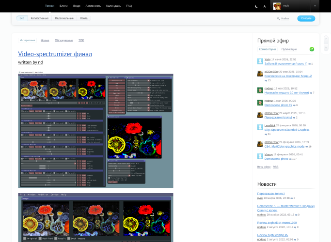
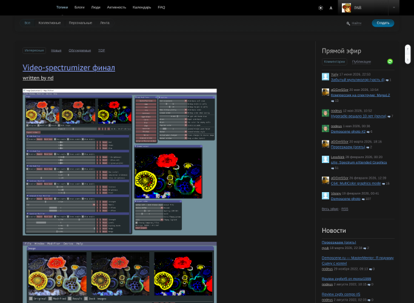
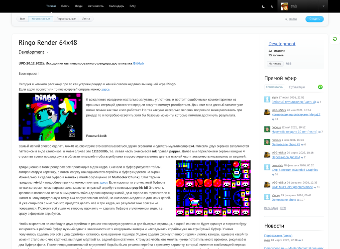
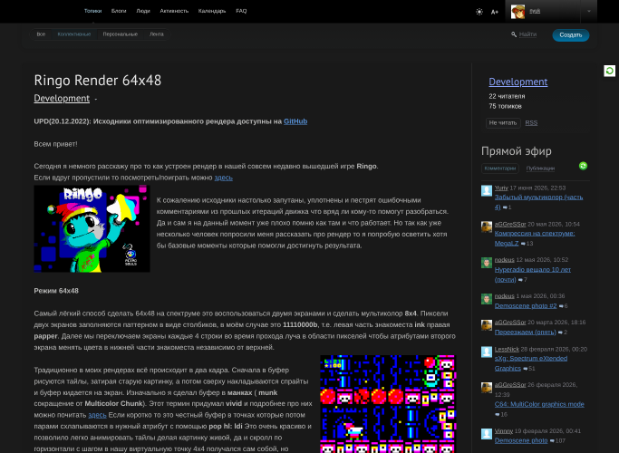
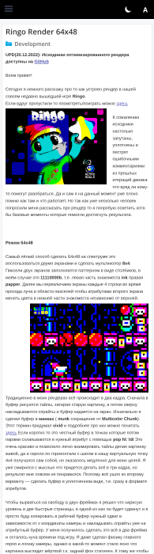
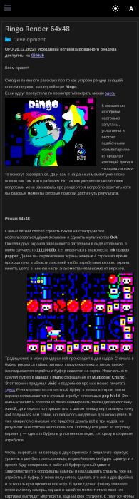
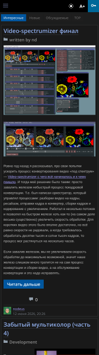

# Настройки отображения: итоговый отчёт

Спецификация: `docs/superpowers/specs/2026-11-14-display-settings-design.md`
План: `docs/superpowers/plans/2026-11-14-display-settings.md`
Код: репозиторий `public_html`, ветка `feature/display-settings` (не слита, не запушена).

## Что сделано

- **Переключатели в шапке** обоих скинов, для гостя и пользователя: тема (луна/солнце) и шрифт (`A`/`A+`).
- **Тема**: без выбора следует системной (`prefers-color-scheme`), явный выбор хранится в `localStorage['hype-theme']`, применяется до отрисовки, синхронизируется между вкладками, без `localStorage` сайт работает в системной теме.
- **Шрифт**: `localStorage['hype-font']`, крупный режим ×1.35 для контента, сайдбара и модальных окон; шапка, меню, голосование, тулбары и подвал не меняются.
- **Мобильная версия**: у карточек топиков убрана рамка; значок темы придвинут к значку шрифта.
- **Мобильная шапка**: «Прямой эфир», «Новости», «Поиск» перенесены в боковое меню; непрочитанное подсвечивает пункт и кнопку меню; старый пункт «Новости» (ссылка на блог) удалён.
- **Цвета** обоих скинов переведены на CSS-переменные (`css/theme.css`): 235 токенов в десктопе, 172 в мобильном, с точными исходными значениями.
- **Тёмная тема**: значения токенов выведены из светлых (`tools/display-settings/lib/color.mjs`), точечные ручные правки — отдельным блоком в `theme.css`; сторонние стили (prettify, markitup, jcrop) переопределены там же.
- **Спрайты**: `icons.png` (оба скина) и `icons2-4.png` (мобильный) получили осветлённые копии `*-dark.png`; переключение — через переменные `--sprite-*`. Разделители, линия сайдбара и пунктир в тёмной теме нарисованы CSS.

## Проверка

- 107 автотестов (`tools/display-settings`, `npm test`): поведение переключателей, кнопки и раскладка шапки, мобильное меню, тёмная тема, состояния после действий пользователя («текущий» комментарий, `mark`/`ins`, уведомления, автодополнение тегов), крупный шрифт, генераторы.
- Светлая тема, обычный шрифт: по сравнению с исходным эталоном отличается только шапка (новые кнопки; в мобильной — перенос иконок). Остальная страница — 0 отличающихся пикселей на 42 скриншотах.
- Контраст в тёмной теме: 0 нарушений на всех страницах матрицы (2 скина × гость/пользователь × обычный/крупный). Порог: 4.5:1 для текста топиков и комментариев, 3:1 для остального.
- Полная матрица скриншотов: 2 скина × гость/пользователь × светлая/тёмная × обычный/крупный, с динамическими элементами (меню пользователя, уведомление, модальное окно, редактор) — 336 снимков, осмотрены выборочно по обзорным листам.

## Скриншоты

| Светлая | Тёмная |
|---|---|
|  |  |
|  |  (крупный шрифт) |
|  |  |
| |  (гость, крупный шрифт) |

## Известные ограничения

- Плавающая панель прокрутки и кнопки «обновить комментарии» в десктопе остаются светлыми: их плашки нарисованы в спрайте `icons-synio.png`.
- В светлой теме контраст части текста ниже WCAG AA (ссылки `#3f8ad7` — 3.6:1, счётчики голосов — 2.66:1). Это исходный дизайн, он не менялся.
- Имена токенов описывают светлое значение (`--text-gray-21` = `#333` в светлой теме), в тёмной теме значение другое. Переименование в смысловые имена — механическая работа на будущее.
- `:where()`/`:is()` и `gap` во flex требуют Safari 14+: на более старых iOS крупный режим увеличит и шапку, а у кнопок в десктопной шапке пропадёт отступ.
- Поиск на локальном стенде выводит PHP-уведомления: контейнер `searchd` не запускается (к задаче не относится).

## Финальное ревью

Независимый ревьюер нашёл нечитаемые в тёмной теме состояния: «текущий» комментарий (1,7–2,8:1), `mark`/`ins`, уведомление в мобильной версии, белые текстуры автодополнения jQuery UI. Исправлено: насыщенные фоны в тёмной теме ограничены светлотой L* 22, для jQuery UI отключены текстуры и заменены иконки; добавлены тесты `states.test.mjs` и `color.test.mjs`.

## Чек-лист выкладки

1. На проде `$config['compress']['css']['use']` должен быть `false`: CSSTidy с уровнем CSS2.1 вырежет `var()` и `calc()`.
2. После выкладки очистить склеенный CSS/JS: `templates/cache/*/`. Хеш склеенного файла сменится сам (новый список файлов), браузерный кеш не помешает.
3. Проверить на проде обе темы и оба размера шрифта в обоих скинах.
